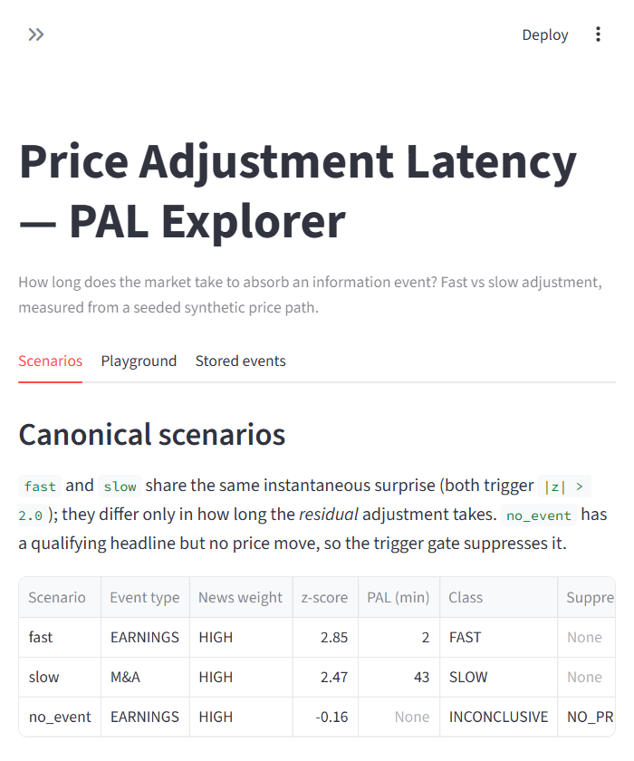
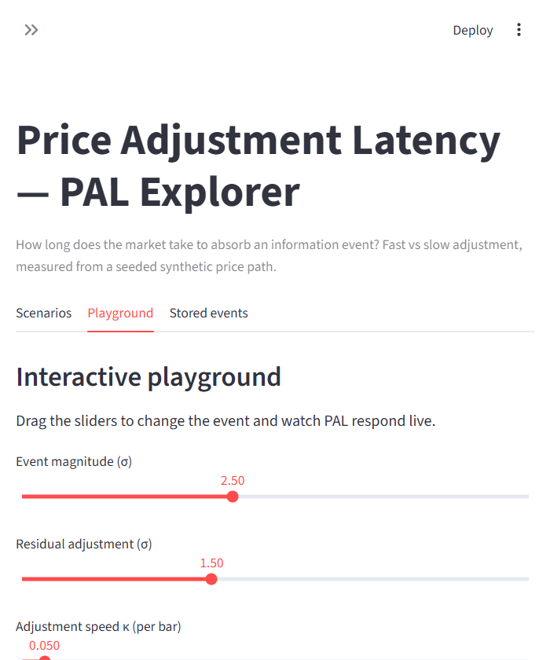
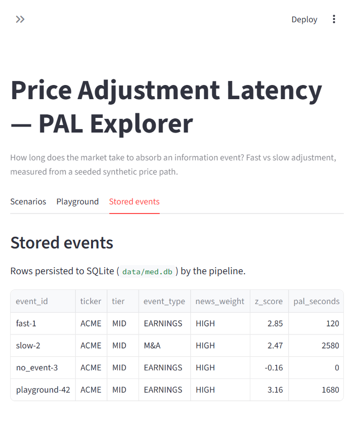

# Market Efficiency Detector (MED) — Price Adjustment Latency

A runnable **vertical slice** of the [MED PRD v3.0](docs/MED_PRD_v3_0_Business_Ready.docx):
prove the core metric — **Price Adjustment Latency (PAL = T_efficient − T_event)** —
computes end-to-end on free, deterministic data, and that it *discriminates*
fast from slow price adjustment.

> **Status:** v0 vertical slice. Measurement-only (no live capital, no signal
> execution). This is the PRD v1 "Solo Analyst" core, compressed to a key-free demo.
> Full progress + decisions: [`build log.md`](build log.md).

## The claim

For a defined equity universe, some information events produce a price path that is
slow and directional enough to be measurable. This slice detects an event, tracks the
price until it reaches and holds an equilibrium band, and emits a
**FAST / NORMAL / SLOW / INCONCLUSIVE** classification with full provenance.

## Quickstart

Requires Python 3.11+.

```bash
python -m venv .venv
# Windows:
.venv\Scripts\activate
# macOS / Linux:
source .venv/bin/activate

pip install -e ".[dev]"        # core + pytest  (add [live] for yfinance)

# Run the demo (end-to-end PAL on 3 synthetic scenarios):
python -m med.demo

# Run the tests (prove discrimination: PAL(slow) > PAL(fast), no-event -> INCONCLUSIVE):
pytest
```

## What you'll see

```
fast       EARNINGS    HIGH     2.51        2.3       FAST
slow       M&A         HIGH     2.49       55.0       SLOW
no_event   EARNINGS    HIGH     0.83         --       INCONCLUSIVE
```

`fast` and `slow` share the same instantaneous "surprise" (both trigger `|z| > 2.0`);
they differ only in how long the *residual* adjustment takes. `no_event` has a
qualifying headline but no price move, so the trigger gate suppresses it — the
"news without price confirmation" null case.

## 🖥️ Streamlit demo (PAL explorer)

An interactive web demo on the same `Pipeline` — no backend changes.

```bash
pip install -e ".[demo]"   # core + streamlit
streamlit run app.py
```

Three views:

- **Scenarios** — runs the 3 canonical scenarios, renders the results table and an
  annotated price chart for each (T_event · T_efficient · equilibrium band).
- **Playground** — sliders for event magnitude (σ) and adjustment speed (κ); the PAL
  and classification update live as you drag.
- **Stored events** — reads `pal_events` back from SQLite, proving persistence.

**Scenarios** — results table + annotated price paths (T_event · T_efficient · equilibrium band):



**Playground** — live PAL as you drag the sliders:



**Stored events** — persisted rows from SQLite:



## The PAL definition (pinned here, not left as a dangling reference)

| Term | Definition |
|---|---|
| **T_event** | `max(ts_published, ts_ingested)` of the news event (PRD §5.3) |
| **Equilibrium** | Median close over the final 20 bars — the anchor for "efficient" |
| **T_efficient** | First bar at/after T_event where close stays within `0.5 · σ_pre · equilibrium` for 5 consecutive bars |
| **σ_pre** | Std of 1-bar log returns over the 60-bar lookback window |
| **Trigger** | `news_weight = HIGH ∧ event_type ∈ {EARNINGS, MACRO, M&A} ∧ |z| > 2.0` within 300s |
| **Class** | FAST ≤ 10 min, NORMAL ≤ 40 min, else SLOW; cap hit or gate fail → INCONCLUSIVE |

> ⚠️ The band/classification thresholds are **placeholder defaults** and must be
> calibrated on real NSE/SGX data in v1. The *algorithm* is the deliverable here,
> not the specific numbers.

## Project layout

```
med/
├── config.py            # all thresholds in one place (pinned, documented)
├── types.py             # pydantic models (PriceBar, NewsEvent, PALEvent, …)
├── provenance.py        # git-sha stamping (PRD §10 reproducibility)
├── data/
│   ├── synthetic.py     # seeded price/event generator (free "mock" path)
│   └── yfinance_source.py  # optional real NSE/SGX intraday (free, no key)
├── agents/
│   ├── statistician.py  # sigma, z-score, equilibrium, T_efficient (no LLM)
│   ├── contextualist.py # VADER sentiment + event taxonomy + news_weight
│   └── decision_maker.py# trigger gate + PAL classification
├── storage/
│   └── sqlite_store.py  # pal_events table (Snowflake stand-in)
├── pipeline.py          # plain-Python orchestration (LangGraph is the v2 upgrade)
└── demo.py              # `python -m med.demo`
app.py                   # Streamlit demo entrypoint (streamlit run app.py)
ui/
└── charts.py            # Altair price-path chart (demo only, not in core package)
```

## What's deliberately out of scope for v0

Kafka/Redpanda, Airflow/Databricks, Snowflake, the full cost-aware vectorbt backtest
(§5), the point-in-time vendor, LLM agents, the signal log, and the backtest equity
curve. Each maps to a later PRD milestone; the slice's job is to make PAL itself
real and testable first (the PRD's own "metric first" publication order).

## Next steps (the PRD ladder)

1. **v1** — run PAL across ~50 real NSE/SGX events (yfinance/RSS), calibrate thresholds, publish the finding.
2. **v2** — swap `pipeline.py` for a LangGraph Statistician + Contextualist graph on a streaming bus.
3. **v2.5** — Signal Generator node, `trade-signals` topic, cost-aware vectorbt backtest, kill criteria.
4. **v3** — Forecaster, SHAP, RAG, Airflow research plane at full scope.

---

**DISCLAIMER:** research prototype only. All signals are paper-traded; no broker
credentials exist anywhere in this codebase. Past simulated performance is not
indicative of future results, and nothing here is investment advice. If this ever
moves toward third-party distribution or live capital, obtain professional advice
on SEBI (India) and MAS (Singapore) requirements first.
